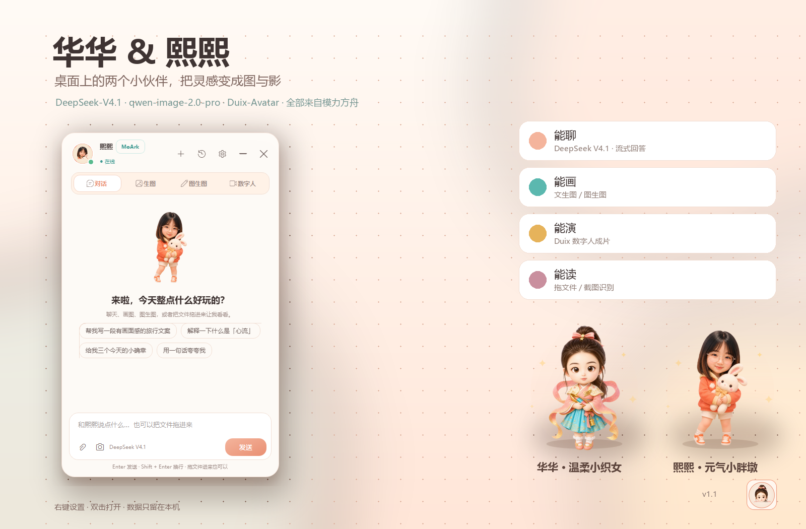
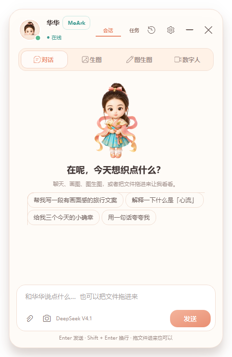
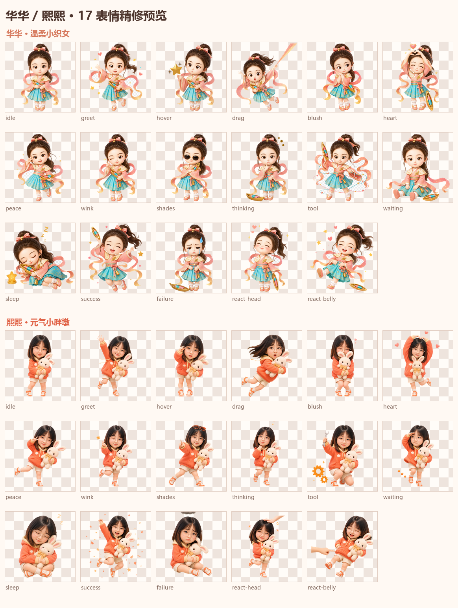
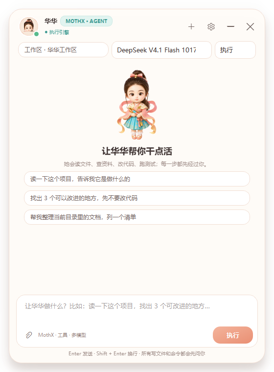
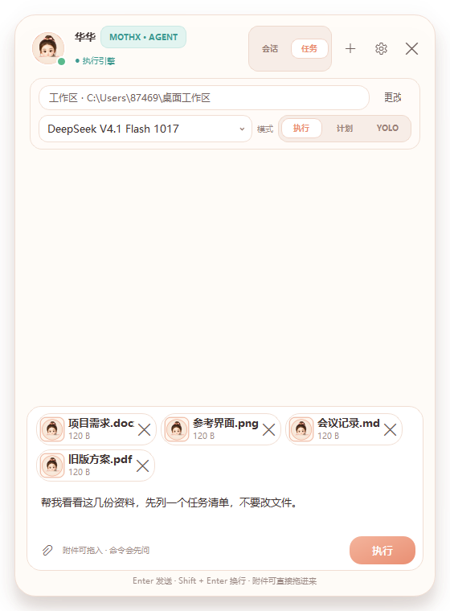
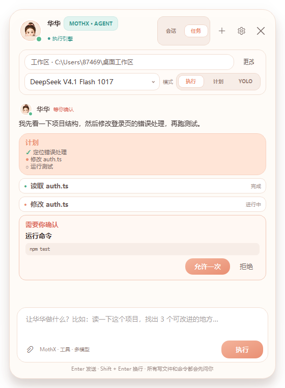

# 华华和熙熙 · 桌面灵感搭子

> 两个住在 Windows 桌面上的小伙伴。点一下打开对话，拖文件给她们看，也能把灵感变成图片和数字人视频。

**GitHub：** <https://github.com/sunlei1214/huahua-desktop>

**MothX Agent 集成设计稿：** [docs/MOTHX_AGENT_DESIGN.md](docs/MOTHX_AGENT_DESIGN.md)



## 界面

对话窗口和执行任务窗口使用同一套顶部「会话 / 任务」切换、同一套角色状态和暖色主题。



## 两个角色，随时切换

- **华华**：温柔小织女。桃粉披帛、青绿裙子，怀里抱着小金梭，说话轻声细语，喜欢把灵感织成画面。
- **熙熙**：元气小胖墩。细银椭圆眼镜、珊瑚橘卫衣，总抱着奶油白长耳兔，说话轻快，行动力满格。

右键 → 设置 → 桌宠外观 → 角色，点一下卡片就能切换。尺寸、透明度、置顶、气泡这些设置会保留；对话历史也会保留，助手头像和名字会一起换。



## 她能做什么

- **聊天**：DeepSeek-V4.1-Flash-1017，流式回答、Markdown 渲染、多轮上下文，华华和熙熙有各自的性格。
- **生图**：qwen-image-2.0-pro，输入画面描述，约 35 秒得到一张 2048×2048 的图。
- **图生图**：把参考图拖进来，写一句“把帽子换成蓝色”“改成吉卜力动画风”即可编辑，最多 3 张参考图。
- **数字人视频**：Duix-Avatar + Qwen3-TTS。上传一段 5–30 秒的人物视频，写口播文案，会自动配音、对口型、合成成片。
- **看图片 / 读文件**：把图片、PDF、Word、PPT、Excel、TXT、视频拖到桌宠或对话框上，会调用 DeepSeek 的图片理解能力，自动读内容、提炼重点。
- **截图问问题**：聊天框左下角的相机按钮，框选屏幕任意区域，直接提问。
- **气泡提醒**：图片或视频生成完，桌宠旁边弹出带缩略图的气泡；点气泡直接回到对应对话。
- **桌宠互动**：摸头、戳肚子、随机小表情、眨眼、打瞌睡、偶尔散步、投喂星星。
- **专注陪伴**：右键 → 陪我专注 25 分钟，结束时提醒你休息。
- **历史记录**：对话自动保存在本机，可随时切换、清空；生成的图片、视频、配音按文件夹归档。
- **右键设置**：角色、大小、透明度、置顶、气泡、声音、待机睡眠、开机启动、存储位置、API 方案管理。

## 执行任务（MothX Agent）

除了轻聊，右键桌宠 → **让华华干活…** 会打开独立的执行任务窗口：



附件可以直接拖进任务窗口或输入框，点小 × 取消：



执行中的工具卡片、计划进度和命令审批：



- 后台运行 `runtime/mothx.exe acp`，通过 ACP 协议连接；
- 支持文件读取、命令执行、搜索、MCP、Skills 等 MothX 工具；
- 工具调用显示成可折叠的小卡片，写文件 / 运行命令会逐次弹出审批；
- 支持切换模型、执行 / 只读计划 / YOLO 模式、工作区选择、停止任务；
- 文件、图片可直接拖进任务窗口或输入框，作为本次任务附件；
- 右上角「会话」切回聊天；聊天右上角「任务」切回任务；
- 切换华华 / 熙熙后，任务窗口里的标题、提示和桌宠气泡会一起换；
- 完成 / 需要确认 / 失败都会回到桌宠气泡；
- 媒体能力（生图、图生图、数字人）仍然走原来的 MoArk 直连，不受影响。

MothX 运行时是外置 sidecar（约 60 MB），放在：

```text
runtime/mothx.exe
```

它不提交到 Git 仓库，避免单文件过大；下载地址：<https://github.com/oschina/mothx/releases>。当前按 `v1.3.107` 验证。

首次执行默认工作区是 `用户目录\桌面工作区`；顶部会显示完整路径，点一下可以换。华华和熙熙共用这个工作区，但各自的标题、提示和气泡会跟着角色切换。

## 直接使用

### 方式一：双击 `华华.exe`

打包好的单文件版本，双击即可。第一次运行会在 `%APPDATA%\HuaHua` 生成本地配置。

### 方式二：从源码启动

```bat
启动华华.bat
```

或：

```bash
python -m pip install -r requirements.txt
python main.py
```

需要 Python 3.10+，Windows 10/11。

## 模型与 API

四个模型全部通过 **模力方舟（MoArk）** 的 OpenAI 兼容接口调用：

| 能力 | 模型 | 接口 |
| --- | --- | --- |
| 对话 / 图片理解 | `DeepSeek-V4.1-Flash-1017` | `POST /v1/chat/completions` |
| 文生图 / 图生图 | `qwen-image-2.0-pro` | `POST /v1/images/generations` |
| 数字人视频 | `Duix-Avatar` | `POST /v1/async/videos/audio-video-to-video` |
| 口播配音 | `Qwen3-TTS` | `POST /v1/async/audio/speech` |

- 默认地址：`https://api.moark.com/v1`
- 默认音色：`Vivian`
- 第一次运行会尝试从同目录的 `工作资料.txt` 读取模力方舟 Key，并用 Windows DPAPI 加密后保存；也可以右键 → 设置 → 接口与模型里手动填写。
- **API 添加**：设置页支持多个接口方案，可以新增、删除、切换；每个方案可单独配置 Key 和四个模型。
- 视频流程是**音频 + 参考视频 → 视频**，不是纯文生视频。没有参考视频时，可以点输入框下方的「示例数字人」，使用内置的 AI 合成示例视频先试一遍。
- 图片编辑走 `images` 参考图参数；qwen-image-2.0-pro 当前云端返回 2048×2048 方图。

> 所有调用都会消耗你账号的 Token / 次数，费用以模力方舟控制台为准。

## 关于抠图精修

这一版把两套角色素材重新做了透明边缘处理：

- 使用 `pymatting` 的 alpha matting 估计前景色，去掉白边 / 绿边污染；
- 对 alpha 边缘做 1px 收边 + 轻微羽化，避免缩放后出现白雾；
- 华华和熙熙统一到 640×640 透明画布，分别放在 `assets/sprites/huahua/` 和 `assets/sprites/xixi/`；
- 头像也单独重做，避免小尺寸下出现白边。

生成脚本在 `tools/refine_assets.py`，可以重复运行。

## 使用小抄

| 操作 | 会发生什么 |
| --- | --- |
| 单击桌宠头部 / 肚子 | 打开对话，同时触发摸头 / 怕痒的小反应 |
| 双击桌宠 | 也会打开对话（并切换成打招呼表情） |
| 右键桌宠 | 快捷菜单：聊天、生图、截图、数字人、专注、大小、置顶、设置、退出 |
| 把文件拖到桌宠 | 打开对话并自动识别 / 总结 |
| 把文件拖到对话框 | 作为附件，由你决定何时发送 |
| 把图片粘贴到输入框 | 自动保存到缓存并作为附件 |
| 拖动生成结果卡片 | 可以把图片 / 视频拖到资源管理器或其他应用 |
| 点击生成结果 | 图片打开内置看图器（滚轮缩放）；视频用系统播放器播放 |

## 设置说明

- **接口与模型**：方案管理、API Key、四个模型、音色、连接测试、超时。
- **桌宠外观**：华华 / 熙熙切换、160–340px 大小、透明度、置顶、待机小动作、散步、气泡开关。
- **存储位置**：作品文件夹、自动打开、保留历史条数、清理历史。默认是 `图片\华华作品`。
- **互动习惯**：通知、提示音、开机启动、深度思考、Enter 发送、待机睡眠、专注时长。
- **关于**：版本、模型列表、隐私说明、官方文档链接。

## 数据与隐私

- API Key 用 Windows DPAPI 加密，只保存在本机；不会写进源码或日志。
- 对话历史、图片、视频、配音都保存在本机。
- 只有你主动发送的文字、图片、文件会传给模力方舟。
- 删除历史不会删除作品文件；删除作品需要自己到存储文件夹里操作。
- 错误日志在 `%APPDATA%\HuaHua\error.log`，不记录 API Key。
- 从旧版 `小织` 升级时，会自动迁移 `%APPDATA%\XiaoZhi` 里的 Key、历史记录和设置；旧作品文件夹不会被删除。

## 项目结构

```text
main.py                 入口
huahua/
  app.py                托盘、桌宠与对话的调度、通知、专注计时
  pet.py                透明桌宠窗口、气泡、右键菜单、拖拽
  chat.py               对话 / 生图 / 图生图 / 数字人界面
  agent_window.py       执行任务窗口（MothX Agent / 工具 / 审批）
  mothx/                ACP 客户端、运行时配置、Agent 控制器
  settings.py           设置中心（含角色切换、MothX 运行时路径）
  api.py                模力方舟四类接口
  workers.py            QThread 后台任务
  widgets.py            气泡、卡片、Markdown 消息等 UI 组件
  config.py             本地配置、旧版迁移与 DPAPI Key
  history.py            JSON 对话历史
  media.py              图片、文档、视频帧处理
  screenshot.py         区域截图
assets/
  sprites/huahua/       华华 17 张精修表情
  sprites/xixi/         熙熙 17 张精修表情
  avatars/              两位角色的头像
  icons/                两位角色的托盘 / 应用图标
  sample_avatar.mp4     AI 合成的示例数字人视频
  icon.ico
  sounds/chime.wav
docs/华华熙熙预览.png
tools/refine_assets.py  可重复运行的抠图精修脚本
```

## 重新打包

```powershell
powershell -ExecutionPolicy Bypass -File .\打包EXE.ps1
```

会生成 `dist\华华.exe`，并复制一份到项目根目录。单文件打包首次启动会解压到临时目录，通常需要几秒。

> Agent 执行模式需要把 `runtime\mothx.exe` 和 `华华.exe` 放在同一层目录。打包脚本不会把 MothX 运行时塞进单文件；移动程序时请把 `runtime` 文件夹一起带走。

## 常见问题

**Q：怎么从华华换成熙熙？**  
右键桌宠 → 设置 → 桌宠外观 → 角色，点「熙熙」卡片，保存并应用。托盘图标、对话头像和名字会一起切换。

**Q：桌宠被其他窗口挡住了？**  
右键 → 始终置顶；或在设置里打开“始终置顶”。

**Q：生成图片一直转圈？**  
qwen-image-2.0-pro 通常需要 30–60 秒；超过 10 分钟请检查网络和 API 额度。

**Q：视频一直等待？**  
Duix-Avatar 是异步任务，通常 20 秒–2 分钟，取决于参考视频长度和队列。设置里可以调大“视频任务”超时。

**Q：没有参考视频怎么做数字人？**  
点视频模式输入框下方的「示例数字人」，会自动放入内置的 AI 合成人像视频；也可以自己录一段 5–30 秒正面人物视频。

**Q：托盘图标不见了？**  
Windows 可能把新图标折叠到任务栏右下角的 `^` 里；也可以重新运行 `华华.exe`，已有实例会提示。

**Q：怎么彻底卸载？**  
退出小工具，删除程序文件夹；再删除 `%APPDATA%\HuaHua` 和你的作品文件夹即可。

## 许可证

- **源代码**：MIT，见 [LICENSE](LICENSE)。
- **角色形象 / 表情 / 头像 / 示例数字人视频**：版权归项目作者所有，不包含在 MIT 授权范围内，仅用于运行、学习和非商业展示，详见 [ASSETS_LICENSE.md](ASSETS_LICENSE.md)。
- **MothX 运行时**：MIT，作为独立 sidecar 使用，详见 [THIRD_PARTY_NOTICES.md](THIRD_PARTY_NOTICES.md)。

## 说明

- 华华原型图来自项目内的 `桌面小工具图片/`；熙熙的原始参考照片与生成中间文件不随仓库发布，仓库只保留最终精修后的透明运行素材。
- Duix-Avatar 的开源项目：<https://github.com/duixcom/Duix-Avatar>
- 模力方舟模型广场：<https://moark.com/serverless-api>
- 模力方舟 API 文档：<https://moark.com/docs/openapi/v1>
