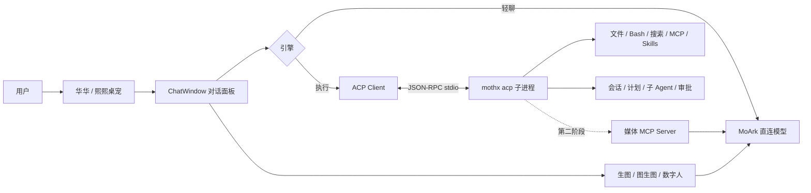

# 华华桌面 × MothX：Agent 集成设计

> 状态：设计稿 v0.1（`dev` 分支）
> 目标：把 MothX 作为 Agent / 工具 / 多模型执行后端，华华和熙熙作为桌面前台。
> 原则：**前台做“陪伴 + 轻量操作”，MothX 做“Agent 运行时 + 深度能力”**，两边不重复造轮子。

---

## 1. 一句话结论

不要在华华里重写 Agent 循环，也不要把 MothX 的 Web UI 硬塞进桌面窗口。

推荐架构：

```text
PySide6 桌面前台（华华 / 熙熙）
        │
        ├── 轻聊引擎：MoArk / DeepSeek（现有，快速、低成本）
        │
        └── 执行引擎：mothx acp（本地 sidecar 子进程）
                │  ACP v1：JSON-RPC over stdio
                │
                ├── Agent 循环 / 计划 / 子 Agent
                ├── 文件、Bash、搜索、MCP、Skills
                ├── Provider / Model 目录与切换
                └── 审批 / 提问 / 会话 / 用量 / 制品
```

**主集成方式选 ACP，不选 Serve。**
Serve 更适合“给外部程序提供一个 OpenAI 兼容 API / Web UI”；ACP 才是 MothX Native 桌面客户端使用的原生协议，能拿到工具调用、审批、提问、计划、子 Agent、模型目录这些“桌面端真正需要”的事件。



Serve 仍然值得保留为第二形态：

- 局域网 / 远程连接 MothX；
- 给其他客户端提供 OpenAI API；
- 在浏览器里使用完整 MothX Web UI。

但在华华桌面里，**ACP 是主路径**。

---

## 2. 为什么这样最合理

### 2.1 不采用“直接调 MothX Serve 的 /v1/chat/completions”作为主路径

Serve 足够简单，但会丢掉最关键的体验：

| 能力 | ACP | Serve OpenAI API |
| --- | --- | --- |
| 工具调用过程 | 结构化事件，可做卡片 | 只有文本 / 有限字段 |
| 工具审批 | `session/request_permission` 反向请求 | 不适合桌面弹卡 |
| 计划模式 | plan 卡片、步骤状态 | 弱 |
| 子 Agent | 生命周期事件、只读轨迹 | 弱 |
| 模型目录 / 能力徽章 | 原生投影 | 需自己拼 |
| 附件 / 制品 | ACP 资源 | 需另做 |
| 本地安全边界 | stdio 子进程，无端口 | 需要 loopback + token |

### 2.2 不采用“把 MothX Web UI 嵌进桌面”

Web UI 是完整的 IDE 式工作台，信息密度很高。华华的用户目标是“桌面上顺手用一下”，不是每天开一个缩小版 VS Code。

所以：

- Web UI 的中低频设置、技能市场、知识库、统计：**不搬**；
- 华华只做高频动作：**聊天、执行任务、模型切换、审批、看结果、收气泡**；
- 需要深度配置时，提供“打开 MothX”入口，不在小面板里堆表单。

### 2.3 不把 Agent 能力写进桌宠进程

Agent 需要跑文件、Bash、长任务，必须隔离在独立进程里：

- 崩溃不影响桌宠；
- 可以重启 / 升级运行时；
- 可以按项目设置工作目录；
- 可以单独限权；
- 未来可以换成本地 / 远程 MothX，而不改 UI。

---

## 3. 双引擎，而不是一个“万能模式”

前台保留两个明确的心智模型：

| 引擎 | 适合 | 特点 |
| --- | --- | --- |
| **轻聊** | 问问题、改文案、看图、生成图片/视频 | 现有 MoArk 直连，快，默认不碰本地文件 |
| **执行** | “帮我改这个项目”“跑一下测试”“查资料并整理” | MothX Agent，可调用工具、子 Agent、多模型 |

### 为什么不让 AI 自动决定？

自动升级到“能改文件”的模式会让用户困惑，也会带来权限和费用风险。建议：

- 第一次默认 **轻聊**；
- 用户点“执行”时，第一次弹出一次性的说明卡：
  - “执行模式可以让华华读写你选择的工作区、运行命令。”
  - 选择工作区；
  - 选择权限：**先询问**（推荐）/ **本次自动允许** / **完全放开（不推荐）**。
- 之后每个会话记住选择，但工作区变化必须重新确认。

### 推荐默认值

- 引擎：轻聊
- 执行模式：`agent`（不是 `yolo`）
- 审批：**每次询问**，可把同类命令加入会话白名单
- 工作区：用户显式选择，默认不选整个磁盘
- 模型：MothX 当前默认模型；首次启动引导选择
- 子 Agent：开启，但默认折叠展示

---

## 4. 前台体验设计

### 4.1 主面板结构

```text
┌────────────────────────────────────────────┐
│ 华华   ● 在线        [轻聊] [执行]   ⚙  —  × │
├────────────────────────────────────────────┤
│ 执行中 · 3 个文件 · 01:42       [停止]       │
│                                            │
│ 你：把登录页的报错处理一下，跑测试          │
│                                            │
│ 华华 计划                                   │
│  1. 定位错误处理                ✓           │
│  2. 修改 auth.ts                ●           │
│  3. 运行 npm test               ○           │
│                                            │
│ ▸ 工具  read_file  src/auth.ts              │
│ ▸ 工具  edit_file   src/auth.ts  +12 -3     │
│                                            │
│ ⚠ 需要你确认                                │
│ 华华想运行：npm test                        │
│ [允许一次] [本会话允许] [拒绝]              │
│                                            │
│ 华华：改好了，测试通过。                    │
│      改了 2 个文件，新增 1 个测试。         │
└────────────────────────────────────────────┘
```

### 4.2 两个引擎的切换

在输入框上方放一个轻量 segmented control：

```text
[ 轻聊 ]  [ 执行 ]
```

- **轻聊**：保留现在的“对话 / 生图 / 图生图 / 数字人”标签。
- **执行**：标签变成“任务”，并出现三个 chip：
  - `工作区：D:\项目\foo`
  - `模型：DeepSeek V4.1`
  - `权限：先询问`
- 切换时不要清空输入；只改变发送目标。
- 执行模式第一次点击时，弹一张“执行模式说明 + 选择工作区”的小卡片；用户确认后进入。

### 4.3 执行中的桌宠状态

| Agent 事件 | 桌宠状态 | 气泡 |
| --- | --- | --- |
| 开始思考 / 规划 | thinking | “我先看看怎么改。” |
| 调用工具 | tool | “在改文件，稍等。” |
| 等待审批 | waiting | “这里需要你点一下。” |
| 子 Agent 运行 | tool / waiting | “小助手在查资料。” |
| 成功 | success | “搞定，测试通过。” |
| 失败 | failure | “卡住了，点我看看原因。” |
| 用户取消 | idle | “好，停了。” |

气泡不只是装饰：

- 审批气泡点击直接打开审批卡；
- 完成气泡带“查看改动 / 打开结果”；
- 长任务超过 30 秒时，气泡显示 elapsed time；
- 多个任务时，显示“还有 2 个任务在跑”。

### 4.4 工具与审批怎么展示才不吓人

工具调用默认**折叠成一行**：

```text
▸ 读取 src/auth.ts                    0.4s
▸ 修改 src/auth.ts                    +12 -3
▸ 运行 npm test                       等待确认
```

展开后才显示参数、命令、diff、输出。审批卡必须包含：

1. **做什么**：人话标题，例如“运行测试”；
2. **具体命令 / 文件路径**；
3. **风险标签**：只读 / 写入 / 执行命令 / 联网；
4. **范围**：一次 / 本会话 / 永久（永久要二次确认）；
5. **拒绝** 和 **停止任务** 始终可见。

不建议把 “yolo” 做成一个普通选项。它应该藏在“高级”里，并明确写：

> 完全放开：华华可以读写文件并执行命令，不再逐次询问。只在你信任的项目里使用。

### 4.5 模型选择

模型选择器不要写死模型名，数据来自 MothX：

- Provider → Model 两级菜单；
- 每个模型显示能力徽章：`工具` / `视觉` / `长上下文` / `推理`；
- 显示上下文窗口和是否支持 thinking；
- 选择后立即作用于当前会话；
- 会话中切换模型时，提示“已切换，历史会保留”；
- 轻聊引擎仍然用 MoArk 的模型；执行引擎用 MothX 的 provider/model，两者不混。

**关键原则：MothX 持有 provider/model 配置，华华只做投影和选择，不复制一份模型清单。**

### 4.6 工作区选择

第一次进入执行模式时：

```text
华华要在一个文件夹里工作

[选择文件夹]  D:\项目\foo
最近：D:\项目\bar  D:\项目\baz

☑ 只允许在这个文件夹内读写
☐ 允许运行命令（仍然逐次确认）

[取消] [开始使用执行模式]
```

- 不能默认整个 `C:\` 或用户主目录；
- 工作区切换要重新确认；
- 每个会话可以绑定不同工作区；
- 桌宠不读取工作区，除非 Agent 触发。

### 4.7 结果与“我到底改了什么”

任务完成后，在对话底部显示一张摘要卡：

```text
本次改动
  M src/auth.ts        +12 -3
  A tests/auth.test.ts +18
  ✓ npm test 通过

[查看 diff] [打开文件夹] [继续修改]
```

桌宠气泡只显示一句人话，不堆技术细节：

> “改好了，测试也过了。要看看改了什么吗？”

### 4.8 出错时

| 情况 | 前台表现 |
| --- | --- |
| 没装 MothX | 执行 tab 显示“需要运行时”，提供“下载 / 选择路径” |
| 运行时版本不兼容 | 阻止启动，显示最低版本和“打开下载页” |
| ACP 启动失败 | 自动重试 1 次；仍失败则回到轻聊，并保留输入 |
| 模型 401 | 打开模型设置，不反复重试 |
| 工具被拒绝 | 显示“已拒绝”，任务暂停，允许用户改指令 |
| 任务超时 | 显示最后一步，提供“继续 / 停止” |
| 进程崩溃 | 标记会话中断，提供“恢复会话” |

---

## 5. 技术架构

### 5.1 进程模型

```text
桌面进程（PySide6）
  ├── PetWindow / ChatWindow
  ├── AgentController（Qt 信号）
  ├── AcpClient（JSON-RPC / stdio）
  │      └── mothx.exe acp  ← 独立进程，随桌面启动
  ├── MediaService（MoArk 图片 / 视频，现有）
  └── MothX MCP Media Server（可选，暴露图片/视频工具）
```

- 启动参数示例（具体 flags 以运行时 `--help` 为准）：

```text
mothx acp --work-dir <workspace> --multi-agent
```

- 不监听端口，不把 token 暴露到网络；
- 桌面进程退出时，先取消 run，再关闭 ACP；
- 运行时独立重启，崩溃不拖垮桌宠。

### 5.2 推荐模块

```text
huahua/mothx/
  runtime.py        # 定位 / 校验 / 启动 / 升级 mothx 二进制
  acp_client.py     # NDJSON JSON-RPC、请求关联、反向请求
  controller.py     # 会话、run、审批、模型目录
  events.py         # ACP 事件 → UI 模型
  models.py         # Provider / Model / Capability 投影
  mcp_media.py      # 把生图/视频暴露为 MCP 工具（第二阶段）
```

不要在 `chat.py` 里直接拼 JSON-RPC。UI 只消费 `controller` 的 Qt 信号：

```text
run_started(session_id)
text_delta(text)
reasoning_delta(text)
tool_started(call)
tool_finished(call)
approval_requested(request)
question_requested(request)
plan_updated(plan)
subagent_updated(subagent)
usage_updated(usage)
run_finished(summary)
run_failed(error)
```

### 5.3 ACP 最小方法集（P1）

| 方法 | 用途 |
| --- | --- |
| `initialize` | 握手、读取 `_meta["mothx.dev"].features` 能力 |
| `mothx/session/draft-config-options` | 新会话前的模型 / thinking 选项 |
| `session/new` | 创建会话（绑定 workspace） |
| `session/prompt` | 发起任务 |
| `session/cancel` | 停止任务 |
| `session/update` | 流式文本 / 工具 / 计划 / 用量 |
| `session/request_permission` | 工具审批 |
| `mothx/requestQuestion` | Agent 提问 |
| `mothx/session/listAll` / `session/load` | 历史会话 |
| `mothx/manage/providers/list` | Provider 目录（按能力开启） |
| `mothx/doctor` | 运行时诊断 |

能力键必须 **gate**：运行时没声明 `manageProviders`，就不显示 provider 编辑；没声明 `subagentPanel`，就不显示子 Agent 面板。

### 5.4 事件到桌宠的映射

```text
session/update(type=tool_call)        → tool
session/update(type=plan)             → thinking
request_permission                    → waiting + 气泡
requestQuestion                       → waiting + 气泡
session/update(type=usage)            → 状态栏
run terminal(success)                 → success + 完成气泡
run terminal(error/cancel)            → failure / idle
```

### 5.5 媒体能力怎么接

MothX 是编码 Agent，不是图片/视频模型网关。建议分两层：

1. **保留现有 MoArk 直连**：华华的“生图 / 图生图 / 数字人”继续走现在的 UI 和 API；
2. **再把媒体能力暴露为 MCP 工具**：

```text
generate_image(prompt, size, reference_images) -> artifact
generate_video(script, reference_video, audio) -> artifact
```

这样 Agent 在任务中可以说“给这个页面配一张图”，自动调用华华的媒体能力；但这属于第二阶段，不影响 P1 的 Agent 主流程。

---

## 6. 运行时与发布

### 6.1 版本策略

- 以 MothX GitHub Releases 为唯一运行时来源；
- 稳定版优先：当前 `v1.3.107`；`v1.3.108-pre-*` 只作为“尝鲜”开关；
- 运行时版本写入配置，升级前做兼容性检查（`mothx --version` + ACP `initialize`）；
- 每个 release 资产校验 SHA-256，不直接执行未校验的下载文件。

### 6.2 分发方式

推荐 **sidecar 外置**，不塞进 PyInstaller 单文件：

```text
华华.exe
runtime/mothx.exe        # 约 25 MB
```

原因：

- 单文件已经 155 MB，再塞 25 MB 启动更慢；
- 运行时需要独立升级；
- 崩溃隔离更自然；
- 用户可以自己替换 `mothx.exe` 做调试。

首次启动：

1. 查找 `runtime/mothx.exe`；
2. 没有则显示“安装执行引擎”；
3. 自动下载对应架构的 release zip；
4. 校验 SHA-256；
5. 解压到 `%APPDATA%\HuaHua\runtime\<version>\`；
6. 运行 `mothx --version` 和 ACP 握手；
7. 失败则回到轻聊，并给出诊断。

### 6.3 平台

- Windows x64 / arm64：release 提供 zip；
- macOS / Linux：同一套 sidecar 逻辑；
- Windows 没有 bwrap，**不能假装有沙箱**：执行安全主要靠工作区白名单 + 审批 + 模式；需要强隔离时建议 WSL / 容器（后续可做）。

---

## 7. 配置草案

```json
{
  "agent": {
    "enabled": true,
    "engine": "chat",
    "runtimePath": "runtime/mothx.exe",
    "runtimeVersion": "1.3.107",
    "autoDownload": true,
    "workspace": "",
    "recentWorkspaces": [],
    "mode": "agent",
    "provider": "",
    "model": "",
    "thinking": "medium",
    "approvalPolicy": "ask",
    "permissionTimeout": 300,
    "maxParallelTasks": 2,
    "showToolDetails": "collapsed",
    "notifyOnApproval": true,
    "notifyOnComplete": true
  }
}
```

- `engine` 是前台概念：`chat` / `agent`；
- `provider` / `model` 为空表示“使用 MothX 默认值”；
- 不把 API Key 写进这个配置；Provider Key 仍由 MothX 管理，媒体 Key 由华华的 DPAPI 管理；
- `yolo` 不放进普通配置，只在高级设置里显式开启。

---

## 8. 分阶段实施

### P0：设计确认（本文件）

- 确认 ACP 主路径；
- 确认双引擎；
- 确认默认 `agent` + 审批；
- 确认 sidecar 外置。

### P1：可用 Agent（建议先做）

- [ ] 运行时定位 / 下载 / 校验 / 启动；
- [ ] ACP 握手与能力探测；
- [ ] `session/new` + `session/prompt` + `session/update` 流；
- [ ] 文本 / 思考 / 工具卡片 / 计划卡片；
- [ ] 审批卡（一次 / 本会话 / 拒绝）；
- [ ] 停止任务；
- [ ] 模型选择器（provider/model/thinking）；
- [ ] 工作区选择与最近目录；
- [ ] 桌宠状态与完成气泡；
- [ ] 会话列表 / 恢复；
- [ ] 运行时错误页与回退轻聊。

### P2：像“搭子”一样执行

- [ ] 子 Agent 折叠面板；
- [ ] diff / 改动摘要 / 打开文件夹；
- [ ] 附件与图片输入；
- [ ] 技能 / MCP 管理器；
- [ ] 媒体 MCP 工具（生图 / 视频）；
- [ ] 审批气泡点击跳转；
- [ ] 任务通知去重与后台会话。

### P3：更完整的 MothX 能力

- [ ] Serve 远程模式（局域网 / 云端）；
- [ ] A2A 远程 Agent 调度；
- [ ] Cron / Workflow；
- [ ] 知识库；
- [ ] 多窗格工作台（如果确实需要）。

**不建议在 P1 就做多窗格、技能市场、知识库。** 先把“一个任务从发起到审批到完成”做顺。

---

## 9. 友好的文案示例

| 场景 | 文案 |
| --- | --- |
| 首次进入执行 | “执行模式可以让华华读写你选中的文件夹、运行命令。每一步都会先问你。” |
| 选择工作区 | “给华华一个工作区吧。她只会在这里动手。” |
| 审批 | “华华想运行 `npm test`，可以吗？” |
| 拒绝 | “已拒绝。你可以改一下要求，或者让她换一种做法。” |
| 长任务 | “还在跑，已经 01:42 了。你可以先去做别的，好了我叫你。” |
| 完成 | “搞定，测试通过。改了 2 个文件。” |
| 失败 | “这一步没成功。要我打开日志看看吗？” |
| yolo 警告 | “完全放开模式不会逐次询问，可能改错文件。只在你自己信任的项目里使用。” |

---

## 10. 关键取舍与待确认

### 推荐已定的

1. **ACP 主路径**，Serve 作为第二形态；
2. **双引擎**，不自动升级权限；
3. **MothX 持有模型目录**，华华只投影；
4. **sidecar 外置**，不塞进单文件；
5. **默认 agent + 审批**，不默认 yolo；
6. **媒体能力先保留直连，第二阶段 MCP 化**。

### 需要你拍板的

1. 运行时是 **随包内置** 还是 **首次下载**？
   - 推荐：随包内置 `runtime/mothx.exe`，同时支持自动更新；安装包大 25 MB，但开箱即用。
2. 默认引擎是 **轻聊** 还是 **执行**？
   - 推荐：轻聊；第一次点执行时再引导。
3. 工作区默认是 **用户选择** 还是 **固定 `华华工作区`**？
   - 推荐：用户选择 + 最近目录，不默认全盘。
4. 是否要在 P1 就接 **媒体 MCP 工具**？
   - 推荐：P2；先把 Agent 主流程跑顺。

---

## 11. 验收标准（P1）

- 用户能在 3 次点击内从桌宠进入“执行”并发起任务；
- 任务流式显示，工具调用不刷屏；
- 所有写文件 / 执行命令都有审批；
- 拒绝审批后任务能停下来，不继续偷偷执行；
- 模型切换后当前会话不丢；
- MothX 缺失 / 崩溃时，轻聊仍然可用；
- 完成 / 审批 / 失败都有桌宠气泡，点击能回到对应任务；
- 公开仓库不出现 API Key、个人参考照片或运行时二进制。

---

*本文件是设计稿，尚未改动现有聊天链路。确认方案后，在 `dev` 分支按 P1 开始实现。*
